<p align="center">
  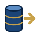
</p>

<h1 align="center">Accesql</h1>

<p align="center">
  <b>Convierte bases de Microsoft Access a MySQL.</b><br>
  Un solo ejecutable, sin Access, sin ODBC y sin Java. Solo lectura.
</p>

<p align="center">
  
  
  
  
  
</p>

<p align="center">
  <a href="#qué-es-accesql">Qué es</a> ·
  <a href="#funcionalidades">Funcionalidades</a> ·
  <a href="#instalación">Instalación</a> ·
  <a href="#cómo-se-usa">Cómo se usa</a> ·
  <a href="#documentación">Documentación</a> ·
  <a href="#estado-del-proyecto">Estado</a>
</p>

---

## Qué es Accesql

**Accesql** lee archivos de Microsoft Access (`.accdb` y `.mdb`) y los ofrece de las formas que hoy se
necesitan: como un **servidor MySQL** al que se conecta cualquier programa, como **JSON**, y como
**scripts SQL de MySQL** para migrar los datos a una base de verdad.

Es un único ejecutable escrito en Go, sin dependencias: no hace falta tener Access instalado, ni
controladores ODBC, ni Java. Corre en Linux y en Windows, incluso en un servidor sin escritorio.

> **Nunca modifica tu archivo de Access.** Lee una copia en memoria (la «imagen») y trabaja siempre
> en modo solo lectura.

### Para qué sirve

- **Seguir usando un sistema viejo hecho en Access** mientras otras aplicaciones (PHP, por ejemplo) leen
  sus datos como si fuera una base MySQL común, sin tocar ni migrar nada.
- **Migrar de Access a MySQL**: crear la base completa con sus tablas, tipos, claves y relaciones, o sumar
  los registros a tablas que ya existen.
- **Explorar y consultar** una base de Access con SQL moderno (`JOIN`, `GROUP BY`, subconsultas) sin abrir
  Access, y exportar el resultado a JSON, CSV o SQL.
- **Ver cómo está armada** una base heredada: tablas, columnas y las relaciones reales entre ellas.

## Funcionalidades

- **Lectura directa** de `.accdb` y `.mdb`, sin Access, ODBC ni Java. Ejecutable único para Linux y Windows.
- **Solo lectura**, con las funciones de archivos del motor SQL desactivadas
  (ver [seguridad](docs/seguridad.md)).
- **Servidor MySQL** integrado: PHP (PDO, mysqli), el cliente `mysql` o cualquier driver se conectan como
  siempre. Con usuario y contraseña obligatorios.
- **Consultas SQL con dialecto MySQL**, con exportación a JSON, CSV para Excel y `INSERT`.
- **Convertir a MySQL**: scripts para crear una base nueva (con claves primarias y `FOREIGN KEY` confirmadas
  con los datos) o para agregar registros a tablas existentes (otro nombre de tabla, columnas a elegir,
  qué hacer con los repetidos, transacción). [Detalle](docs/convertir-a-mysql.md).
- **Diagrama de relaciones** con las relaciones reales definidas en Access.
- **Dos interfaces que se comportan igual** y comparten la misma base cargada: un menú en la terminal y
  una página en el navegador.

### Menú en la terminal

Se abre sin argumentos (también con doble clic). Un menú de opciones con el mismo aspecto, la elegida
resaltada y las que todavía no se pueden usar en gris. Sirve incluso por SSH.

<p align="center">
  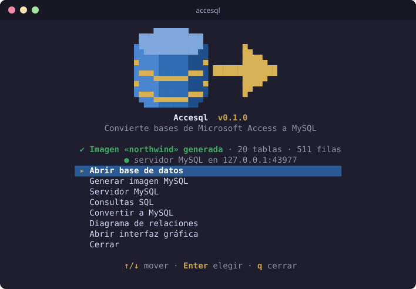
</p>

<table>
  <tr>
    <td width="50%">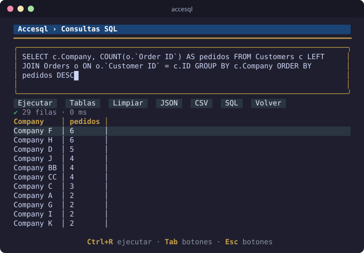<br><sub><b>Consultas SQL</b> con grilla desplazable y exportación.</sub></td>
    <td width="50%">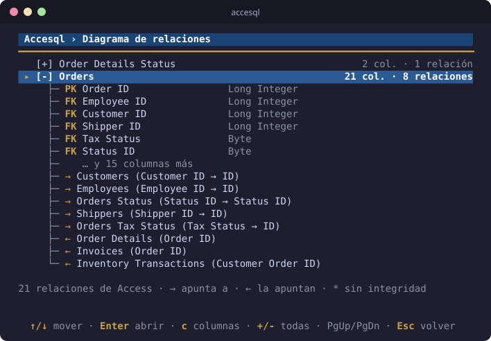<br><sub><b>Diagrama</b> como árbol de tablas, columnas y relaciones.</sub></td>
  </tr>
  <tr>
    <td width="50%">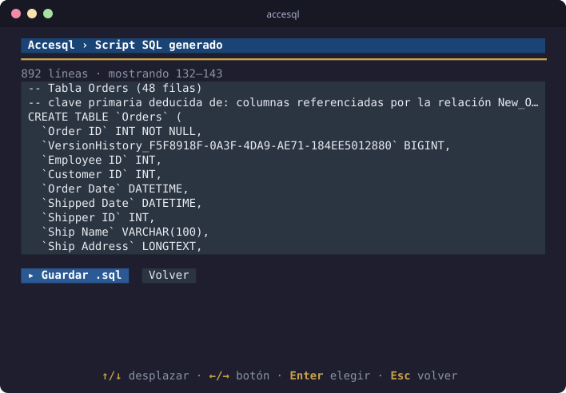<br><sub><b>Convertir a MySQL</b>: el script generado, listo para guardar.</sub></td>
    <td width="50%">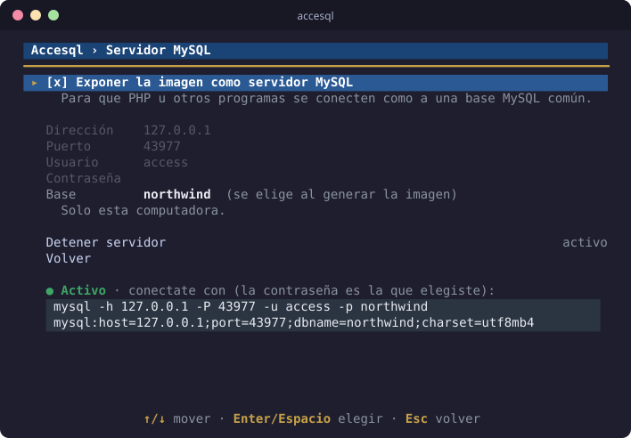<br><sub><b>Servidor MySQL</b> con el comando de conexión.</sub></td>
  </tr>
</table>

### Interfaz gráfica en el navegador

Una sola pantalla, de arriba hacia abajo: abrir la base, generar la imagen y, a partir de ahí, lo que
haga falta. **Solo el primer bloque está activo hasta generar la imagen; el resto es opcional.** Todo
va dentro del ejecutable: sin internet, sin CDN.

<p align="center">
  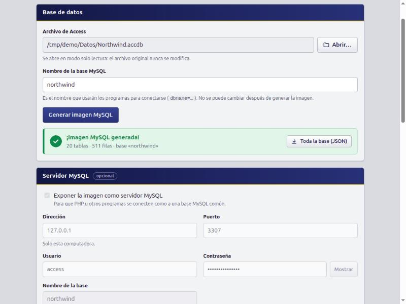
</p>

| | |
|---|---|
| 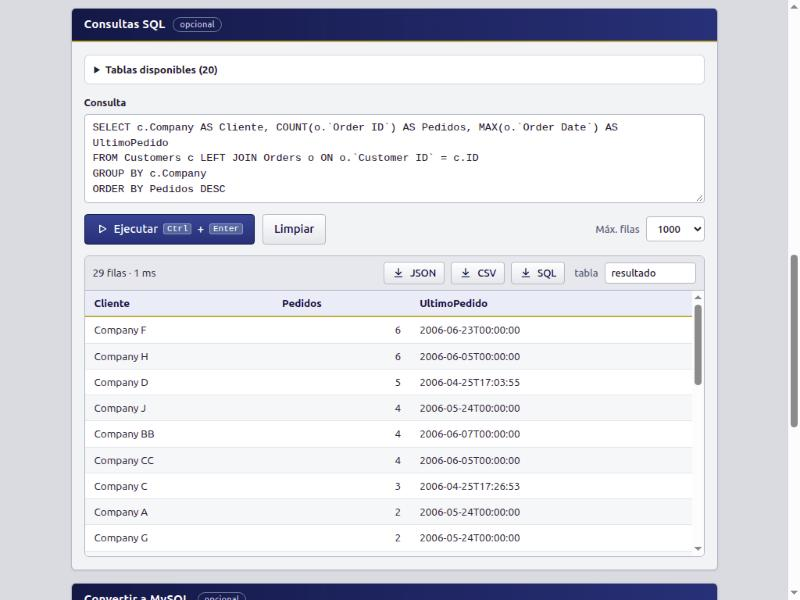<br><sub><b>Consultas SQL</b> y exportación a JSON, CSV o SQL.</sub> | 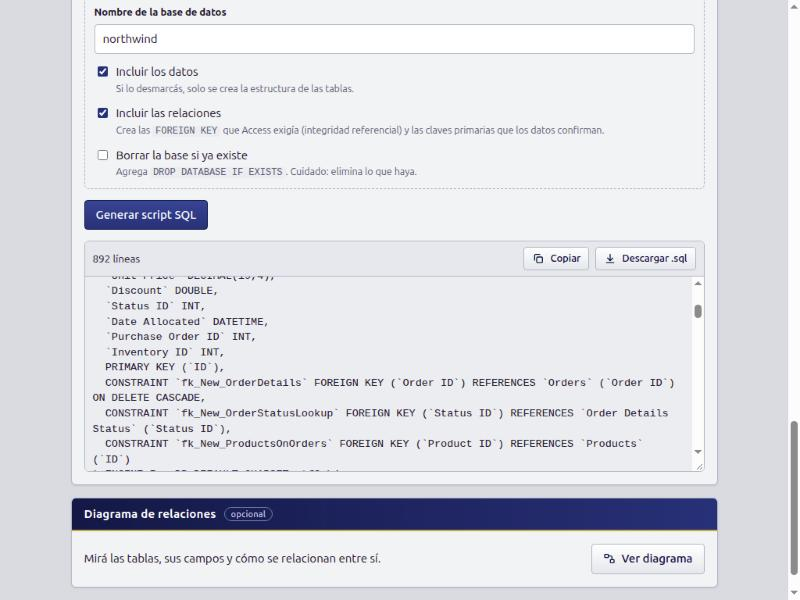<br><sub><b>Convertir a MySQL</b> con vista previa y descarga del script.</sub> |
| 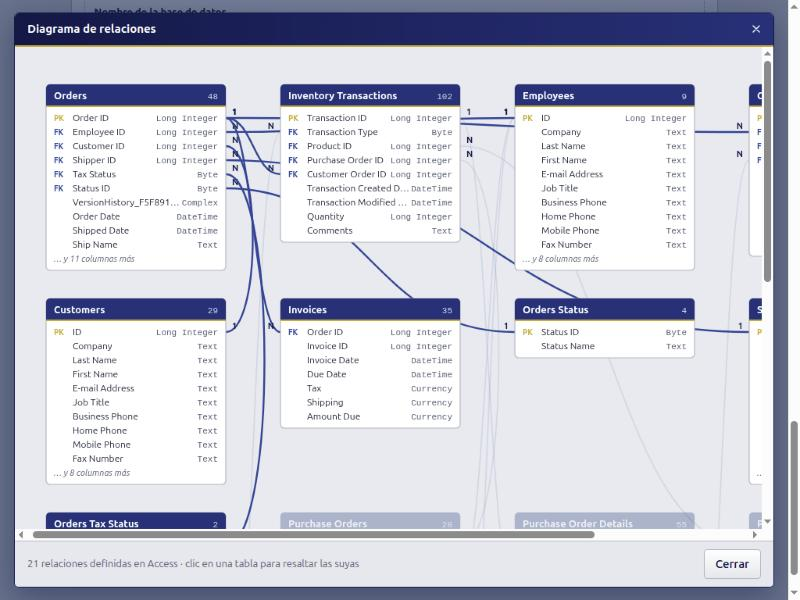<br><sub><b>Diagrama de relaciones</b>: un clic en una tabla resalta las suyas.</sub> | 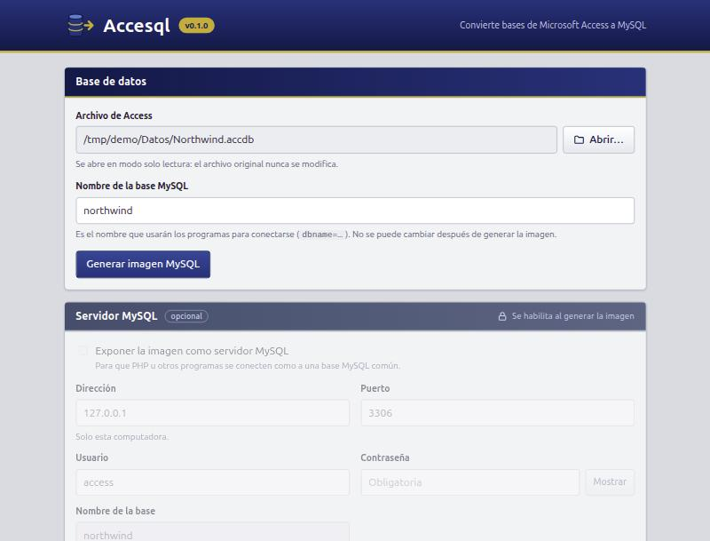<br><sub><b>Primer paso</b>: elegir el archivo y el nombre de la base.</sub> |

Los cinco bloques son: **Base de datos** (explorador de carpetas, generar la imagen con progreso),
**Servidor MySQL**, **Consultas SQL**, **Convertir a MySQL** y **Diagrama de relaciones**.

## Instalación

Accesql es un único ejecutable. No necesita instalación.

**Binarios precompilados.** La idea es adjuntar los ejecutables para Linux y Windows a cada versión en
la pestaña *Releases* del repositorio. *Todavía no hay versiones publicadas*: por ahora, compilá desde el
código fuente.

**Compilar desde el código fuente.** Requiere [Go](https://go.dev/dl/) 1.26 o superior. No hace falta
compilador de C.

```bash
git clone https://github.com/mdev-repos/accesql.git
cd accesql

# Linux
CGO_ENABLED=0 go build -trimpath -ldflags="-s -w" -o bin/accesql ./cmd/accesql

# Windows (también desde Linux)
GOOS=windows GOARCH=amd64 CGO_ENABLED=0 go build -trimpath -ldflags="-s -w" -o bin/accesql.exe ./cmd/accesql
```

> En Windows el ejecutable compila, pero todavía no se probó en una máquina Windows real.

## Cómo se usa

El ejecutable se llama `accesql`. Elegí la forma que te convenga.

### 1. Con el menú de la terminal

```bash
accesql                    # o doble clic en el ejecutable
accesql -f datos.accdb     # con la base ya elegida
```

Recorré las opciones con `↑`/`↓`, `Enter` para elegir y `Esc` para volver.
Necesita una terminal de al menos 80×24.

### 2. Con la interfaz gráfica

```bash
accesql web --open
```

Se abre el navegador con la página. El programa imprime un enlace con un token (`…/#t=…`): es la llave de
acceso, tratalo como una contraseña. También se puede abrir desde el menú de la terminal
(*Abrir interfaz gráfica*), compartiendo la misma base ya cargada.

### 3. Como servidor MySQL para otras aplicaciones

```bash
export ACCESQL_PASSWORD='una-clave-larga'
accesql serve --file datos.accdb --port 3306
```

```php
$pdo = new PDO('mysql:host=127.0.0.1;port=3306;dbname=access;charset=utf8mb4',
               'access', getenv('ACCESQL_PASSWORD'));
$filas = $pdo->query('SELECT * FROM Clientes LIMIT 10')->fetchAll(PDO::FETCH_ASSOC);
echo json_encode($filas);
```

### 4. Para scripts: JSON y consultas por línea de comandos

```bash
# Una tabla, o todas, como JSON
accesql dump --file datos.accdb --table Products
accesql dump --file datos.accdb --out salida/

# Una consulta SQL (dialecto MySQL)
accesql query -f datos.accdb -q 'SELECT COUNT(*) AS clientes FROM Customers'
```

### Migrar a MySQL, paso a paso

1. Abrí la base (menú o página) y **generá la imagen**.
2. Entrá a **Convertir a MySQL** y elegí *Crear una base nueva* (o *Agregar datos a tablas que ya existen*).
3. Revisá el script en pantalla y **guardalo**.
4. Ejecutalo en tu servidor: `mysql -u root -p < northwind.sql`.

Más opciones y cómo se arman los scripts: [Convertir a MySQL](docs/convertir-a-mysql.md).

### Preguntas frecuentes

- **¿Modifica mi archivo de Access?** No. Es de solo lectura y trabaja con una copia en memoria.
- **¿Necesito Access instalado?** No, ni ODBC ni Java.
- **¿Qué pasa si el archivo cambia?** La imagen es una foto. Con el menú o la página se vuelve a generar;
  `serve` puede recargarse solo con `--reload-every`.
- **¿Qué tamaño de base soporta?** Se copia entera a memoria RAM. Con bases grandes todavía no se midió el
  consumo ni los tiempos: probalo con tu archivo antes de depender de él.
- **¿Funcionan las imágenes y objetos OLE?** Todavía no: ver [limitaciones](docs/tipos-y-limitaciones.md).

## Documentación

| Documento | Contenido |
|---|---|
| [Referencia de comandos](docs/comandos.md) | todas las opciones de `dump`, `query`, `serve`, `web` y el menú |
| [Convertir a MySQL](docs/convertir-a-mysql.md) | los dos modos, tipos, claves, relaciones y compatibilidad |
| [Seguridad](docs/seguridad.md) | modelo de seguridad y sus límites |
| [Tipos y limitaciones](docs/tipos-y-limitaciones.md) | conversión a JSON, comparación de texto, lo que todavía no funciona |
| [Desarrollo](docs/desarrollo.md) | compilar, tests, estructura del proyecto, cómo contribuir |

## Estado del proyecto

**Versión 0.1.0, MVP en pruebas.** Las funciones principales están completas y probadas con la base de
ejemplo *Northwind* (tests automáticos, PHP 8.3 real, el cliente `mysql` y scripts ejecutados en un
MariaDB real). Lo que todavía falta, con total honestidad:

- Probar en Windows y con **MySQL 8**, y medir memoria y tiempos con **bases grandes**.
- Las columnas **OLE** (imágenes y objetos incrustados) no se leen bien (defecto de una dependencia).
- Ejecutables publicados para Linux y Windows.

## Contribuir

Se agradecen los reportes de errores, las pruebas con bases reales y las mejoras. Antes de enviar un
cambio: `gofmt -l .`, `go vet ./...` y `go test ./...` deben pasar. Más en [Desarrollo](docs/desarrollo.md).

## Licencia

*Pendiente de definir.* Hasta que se publique una licencia, todos los derechos están reservados.

## Créditos

Accesql se apoya en proyectos abiertos:
[mdbgo](https://github.com/Felamande/mdbgo) (lectura de Access en Go puro),
[go-mysql-server](https://github.com/dolthub/go-mysql-server) (motor SQL con dialecto MySQL),
[Bubble Tea, Lip Gloss y Bubbles](https://github.com/charmbracelet) (menú de la terminal),
[Cobra](https://github.com/spf13/cobra) (línea de comandos) y
[mdbtools](https://github.com/mdbtools/mdbtools) (referencia para verificar la lectura).
La base de ejemplo *Northwind* es de Microsoft y no se distribuye con este repositorio.
