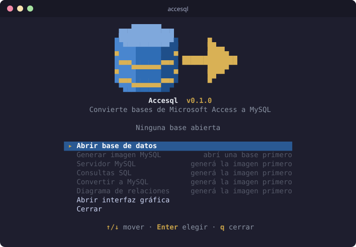

# Referencia de comandos

El ejecutable se llama `accesql`. Sin argumentos abre el [menú interactivo](#menú-interactivo-sin-argumentos);
los comandos (`dump`, `query`, `serve`, `web`) sirven para scripts y automatización.

```text
accesql [-f archivo]                 menú interactivo en la terminal
accesql dump  -f archivo [-t tabla] [-o carpeta]
accesql query -f archivo -q "SELECT ..."
accesql serve -f archivo [--host ...] [-p 3306] [-u usuario] [-d base] [--reload-every 5m]
accesql web   [-f archivo] [--host ...] [-p 8080] [--open]
```

`accesql --help` (o `-h`) muestra la ayuda, `accesql ayuda <comando>` la de un comando y `accesql --version`
(`-v`) la versión. Los mensajes informativos van a `stderr`; los datos, a `stdout`. Todo es de **solo lectura**:
el archivo de Access nunca se modifica.

---

## Menú interactivo (sin argumentos)

```bash
accesql                    # menú interactivo
accesql -f datos.accdb     # con la base ya elegida
```

Es lo que ocurre al hacer doble clic en el ejecutable. Un menú con el logo de Accesql: las opciones
tienen el mismo aspecto, la elegida va con barra azul y las que todavía no se pueden usar quedan en
gris (el cursor las saltea). Cada pantalla interna termina con **Volver**, y `Esc` hace lo mismo.

<p align="center">
  
</p>

Necesita una terminal de al menos **80×24**: si es más grande centra el contenido, si es más chica
pide agrandarla. Sin una terminal de verdad (un pipe o un script) muestra la ayuda de siempre.

| Opción | Qué hace |
|---|---|
| Abrir base de datos | explorador de carpetas (solo `.accdb` y `.mdb`) |
| Generar imagen MySQL | nombre de la base, barra de progreso, `Esc` cancela |
| Servidor MySQL | iniciar y detener el servidor (dirección, puerto, usuario, contraseña obligatoria) |
| Consultas SQL | editor, **Tablas** (elegir una), grilla con scroll y exportar a JSON / CSV / SQL |
| Convertir a MySQL | script de base nueva, o `INSERT` a tablas existentes ([detalle](convertir-a-mysql.md)) |
| Diagrama de relaciones | árbol de tablas con columnas, PK/FK y las relaciones reales de Access |
| Abrir interfaz gráfica | levanta la web **sobre la misma base ya cargada** y abre el navegador |
| Cerrar | sale |

Teclas del editor de consultas: `Ctrl+R` ejecuta, `Tab` pasa del editor a los botones y a la grilla,
`Esc` vuelve atrás. En el diagrama: `Enter` abre una tabla, `c` muestra todas las columnas, `+`/`-`
abren o cierran todas.

Se traen hasta 1.000 filas por consulta (avisa si hay más) para que un `SELECT *` enorme no cuelgue la
pantalla; las exportaciones traen todo (hasta 1.000.000 de filas). Los archivos que genera (resultados
y scripts) se guardan **junto a la base abierta**, o en la carpeta de trabajo si ahí no se puede escribir.

---

## `dump`: exportar a JSON

```bash
# Una tabla por stdout
accesql dump --file datos.accdb --table Products

# Todas las tablas: un <tabla>.json por tabla en la carpeta indicada
accesql dump --file datos.accdb --out salida/
```

| Opción | Descripción |
|---|---|
| `-f, --file` | archivo `.accdb` / `.mdb` (obligatorio) |
| `-t, --table` | exportar solo esa tabla |
| `-o, --out` | carpeta de salida (un `.json` por tabla); sin esto imprime por stdout |

Las columnas salen en el mismo orden que en Access. Ver [tipos y limitaciones](tipos-y-limitaciones.md)
para cómo se convierte cada tipo.

---

## `query`: consultas SQL

`query` carga el archivo en un motor SQL en memoria
([go-mysql-server](https://github.com/dolthub/go-mysql-server)) y ejecuta la consulta con **dialecto
MySQL**: `JOIN`, `GROUP BY`, subconsultas, etc. (algo que el SQL propio del lector de Access no
soporta). Las columnas salen en el orden del `SELECT`.

```bash
accesql query -f datos.accdb -q \
  'SELECT c.Company, COUNT(*) AS pedidos
     FROM Customers c JOIN Orders o ON o.`Customer ID` = c.ID
    GROUP BY c.Company ORDER BY pedidos DESC LIMIT 3'
```

Los nombres con espacios o símbolos (`Order Details`, `Country/Region`) van entre comillas invertidas.
Los datos son una foto de solo lectura: cualquier escritura SQL afecta solo la copia en memoria, nunca
el `.accdb`. En `query` los Sí/No salen como `0`/`1` (como en MySQL); `dump` los emite `true`/`false`.

| Opción | Descripción |
|---|---|
| `-f, --file` | archivo `.accdb` / `.mdb` (obligatorio) |
| `-q, --sql` | consulta SQL (obligatorio) |

---

## `serve`: servidor MySQL

`serve` expone el Access como si fuera un servidor MySQL, de modo que las aplicaciones (PHP con
PDO/mysqli, etc.) se conectan con su driver de siempre. Es de **solo lectura**: `INSERT`/`UPDATE`/`DELETE`
devuelven un error claro.

```bash
export ACCESQL_PASSWORD='una-clave-larga'
accesql serve --file datos.accdb --port 3306
```

Desde PHP:

```php
$pdo = new PDO('mysql:host=127.0.0.1;port=3306;dbname=access;charset=utf8mb4',
               'access', getenv('ACCESQL_PASSWORD'));
$filas = $pdo->query('SELECT * FROM Clientes LIMIT 10')->fetchAll(PDO::FETCH_ASSOC);
echo json_encode($filas);
```

| Opción | Descripción |
|---|---|
| `-f, --file` | archivo `.accdb` / `.mdb` (obligatorio) |
| `--host` | dirección donde escuchar (por defecto `127.0.0.1`; `0.0.0.0` expone a toda la red) |
| `-p, --port` | puerto TCP (por defecto `3306`) |
| `-u, --user` | usuario para conectarse (por defecto `access`) |
| `--password` | contraseña; mejor usar la variable `ACCESQL_PASSWORD`, porque `--password` queda visible en la lista de procesos. **Sin contraseña no arranca.** |
| `-d, --database` | nombre de la base que ven los clientes (por defecto `access`) |
| `--reload-every` | revisar el archivo cada este tiempo y recargarlo si cambió (ej. `5m`; `0` = nunca) |

Ver [seguridad](seguridad.md) antes de exponerlo a la red.

### Recarga automática (`--reload-every`)

Es una foto del archivo. Con `--reload-every 5m` el servidor revisa su fecha y tamaño cada 5 minutos y,
si cambió (y lleva más de 2 s sin tocarse, por si Access lo está escribiendo), lo recarga.

- **Durante la recarga las consultas se pausan** (decenas de milisegundos con Northwind; con bases grandes
  será proporcional) y luego siguen con los datos nuevos, incluidas las sentencias preparadas abiertas.
- Para no duplicar la memoria se reemplaza **tabla por tabla** (el pico extra es el de la tabla más grande).
- Si el archivo está corrupto, el error se registra, el servidor sigue con los datos anteriores y reintenta
  en el próximo ciclo. Si falla a mitad, pueden quedar unas tablas nuevas y otras viejas hasta el reintento.
- Sin `--reload-every`, hay que reiniciar para recargar. Se apaga limpiamente con `Ctrl+C` o `SIGTERM`.

---

## `web`: interfaz gráfica

```bash
accesql web --open                 # elegís el archivo desde la página
accesql web -f datos.accdb --open  # o lo dejás preseleccionado
```

Levanta la página local y, al iniciar, imprime un enlace del estilo
`http://127.0.0.1:8080/#t=<token>` (`--open` lo abre solo). El token es obligatorio: sin él la API
responde 401. Si reiniciás el programa, el token cambia: pegá el enlace nuevo.

| Opción | Descripción |
|---|---|
| `-f, --file` | archivo a preseleccionar (opcional) |
| `--host` | dirección donde escuchar (por defecto `127.0.0.1`). `0.0.0.0` expone la interfaz **sin cifrado** |
| `-p, --port` | puerto HTTP (por defecto `8080`; `0` elige uno libre) |
| `--open` | abrir el navegador automáticamente |

Los cinco bloques de la página (base de datos, servidor MySQL, consultas, convertir a MySQL y diagrama)
se describen en el [README](../README.md#funcionalidades). La interfaz comparte con el menú de la terminal
la misma lógica: lo que se hace en una se ve en la otra.
